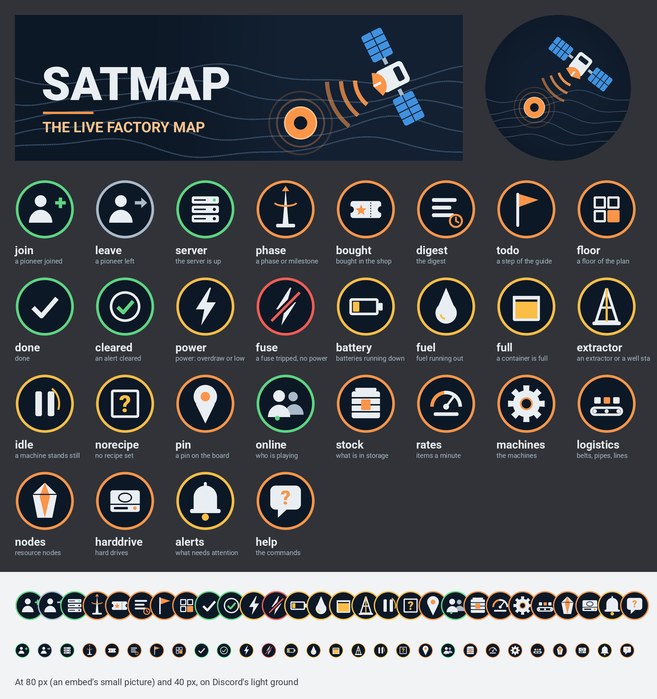

# SatMap Discord Bot

Slash commands, a live status board, news and alerts for a **Satisfactory** dedicated server that runs the **SatMap**
mod. The bot reads SatMap's own pages on the game server (port 8765) and writes to Discord. It never sends anything
to the game, needs no change to the mod, and only makes outgoing connections, so no port has to be opened for it.



## Commands

| Command | Answer |
| --- | --- |
| `/status` | The server at a glance: who is on, power, alerts, phase, the Space Elevator's next delivery, last save |
| `/online` | Who is playing and where, named after the plan's floors or by distance and direction from the HUB |
| `/power` | Every power grid: use, capacity, batteries, a blown fuse |
| `/stock [item]` | What is in storage; with an item: which containers hold it and how long it lasts |
| `/rates [item]` | Items made and used a minute; with an item: the machines on that recipe and how hard they run |
| `/machines [machine]` | Every kind of machine and how many are producing, idle or without power; with a name: each one |
| `/logistics` | Belts, lifts, pipes and power lines by tier and length, splitters, mergers, poles |
| `/nodes [resource]` | Resource nodes by kind; with a resource: purity and the nearest free ones |
| `/alerts` | Everything that needs attention, worst first, with place and age |
| `/elevator` | What the Space Elevator still needs |
| `/digest` | What has been built, taken down and bought |
| `/harddrives` | Crash sites that still hold a hard drive, nearest first |
| `/todo` | The shared to-do list and pins |
| `/help` | The list |

Item, machine and resource names are suggested as you type. Each of these is switched on by naming a channel:

- **Live board**: one message with the status and the open alerts, edited in place. After a restart the bot finds
  its own board message again, so the channel never fills up with old boards.
- **News**: a pioneer joined or left, the server went down or came back.
- **Alerts**: a message when something goes wrong, marked "Cleared" when it is put right.

SatMap can post news and alerts itself through its webhook. Use the bot's or the webhook's for those, not both, or
each one arrives twice.

## The bot's account

1. [Discord developer portal](https://discord.com/developers/applications), **New Application**. On the **Bot** page
   set its name, its picture (`art/satmap-webhook-512.png`) and its banner (`art/satmap-banner.png`), and press
   **Reset Token**. The token is a password. No privileged intent is needed: leave all three off.
2. Invite it: **OAuth2**, **URL Generator**, scopes `bot` and `applications.commands`, permissions View Channels,
   Send Messages, Embed Links, Attach Files and Read Message History. By hand:
   `https://discord.com/oauth2/authorize?client_id=YOUR_APPLICATION_ID&scope=bot+applications.commands&permissions=117760`

## Run it with Docker

```bash
cp .env.example .env        # fill in SATMAP_BOT_TOKEN and SATMAP_GUILD_ID, at least
docker compose up -d
docker logs -f SatMap-Discord-Bot
```

The log says `14 commands set in server ...` and `logged in as ...`. The container runs as an unprivileged user on a
read-only file system with every capability dropped; it writes only to `/tmp`.

### In DCS (dcs-orchestrator)

`dcs-template/satmap-bot/` is a ready template: copy that folder into the orchestrator's `.templates/` as
`.templates/satmap-bot/` and deploy it from the dashboard. The token is read from the DCS secret store as
`${SECRETS_SATMAP_TOKEN}`: add a secret named `SATMAP_TOKEN` first. The form asks for the server ID and the rest. Its
variables are named `SATMAP_...`, so it sits beside the DCS bot in one stack without sharing anything.

## Settings

The image reads these from its environment. `docker-compose.yml` and the DCS template fill them from the `.env`
names in the second column.

| In the container | In `.env` | What it does | Default |
| --- | --- | --- | --- |
| `DISCORD_BOT_TOKEN` | `SATMAP_BOT_TOKEN` | The bot's token | required |
| `DISCORD_GUILD_ID` | `SATMAP_GUILD_ID` | Your Discord server's ID: commands appear there at once. Empty: global, which Discord may take an hour to show | empty |
| `SATMAP_URL` | `SATMAP_URL` | Where SatMap answers, as seen from the container | `http://host.docker.internal:8765` |
| `SATMAP_MAP_URL` | `SATMAP_MAP_URL` | The map's address: adds an "Open the map" button to every answer | none |
| `DISCORD_CHANNEL_IDS` | `SATMAP_CHANNEL_IDS` | Channels where answers are public; asked elsewhere, only the asker sees the answer | everywhere |
| `DISCORD_ROLE_IDS` | `SATMAP_ROLE_IDS` | Roles that may use the commands | everyone |
| `SATMAP_BOARD_CHANNEL_ID` | same | Channel for the live board | off |
| `SATMAP_NEWS_CHANNEL_ID` | same | Channel for news | off |
| `SATMAP_ALERTS_CHANNEL_ID` | same | Channel for alerts | off |
| `SATMAP_ALERTS_MIN_SEVERITY` | same | 1 everything, 2 warnings and faults, 3 faults only | 2 |
| `SATMAP_ALERTS_MENTION` | same | Who to ping on a fault, e.g. `<@&ROLE_ID>` | none |
| `SATMAP_PRIVATE_REPLIES` | same | `true`: every answer is shown to the asker alone | `false` |
| `TZ` | `TZ` | Time zone for the log | `UTC` |

Also read by the image, with sensible defaults: `SATMAP_BOARD_SECONDS` (60), `SATMAP_PRESENCE` (true),
`SATMAP_PRESENCE_SECONDS` (60), `SATMAP_NEWS_JOINS` (true), `SATMAP_NEWS_SERVER` (true), `SATMAP_ALERTS_CLEARED`
(true), `SATMAP_ALERTS_MENTION_SEVERITY` (3), `SATMAP_BADGES` (true), `SATMAP_TIMEOUT_SECONDS` (6),
`SATMAP_DATA_DIR` (a folder to keep `memory.json` in; without one it lives in `/tmp`).

IDs: switch on Developer Mode (User Settings, Advanced), then right-click the server, a channel or a role and choose
Copy ID.

## Without Docker

Python 3.10 or newer: `pip install -r requirements.txt`, copy `config.example.json` to `config.json` and fill it in
(the same settings by name), then `python bot.py`. Environment variables win over the file.

## For whoever changes it

- `satmap_data.py` holds every answer and knows nothing of Discord. `python satmap_data.py stock "Iron Plate" --url
  http://your-server:8765` prints one in a terminal.
- `python bot.py --check` reads the settings, asks SatMap once, builds every answer and stops, with no login.
- `python preview.py --url http://your-server:8765` draws `preview.png`, a likeness of the answers in Discord's dark
  theme (needs Pillow).
- `bot.py` is the Discord side (discord.py 2.x). The image is built by `.github/workflows/docker.yml` whenever
  `VERSION` or the program changes on `main`, and tagged with the version, its short form and `latest`.
- It reads `/state`, `/stock`, `/rates`, `/world`, `/nodes`, `/digest`, `/board`, `/plancheck` and the site's
  `plan.json`. A SatMap that changes the shape of those rows needs the matching change in `satmap_data.py`.
